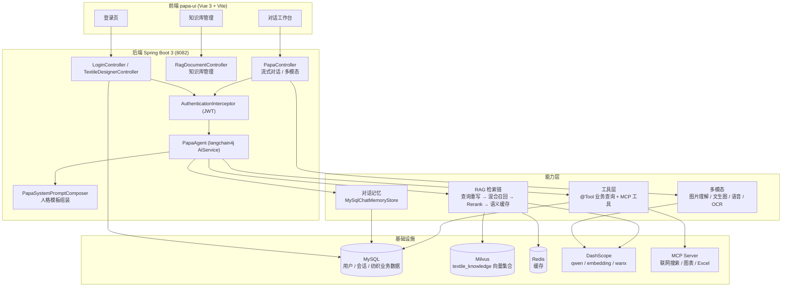
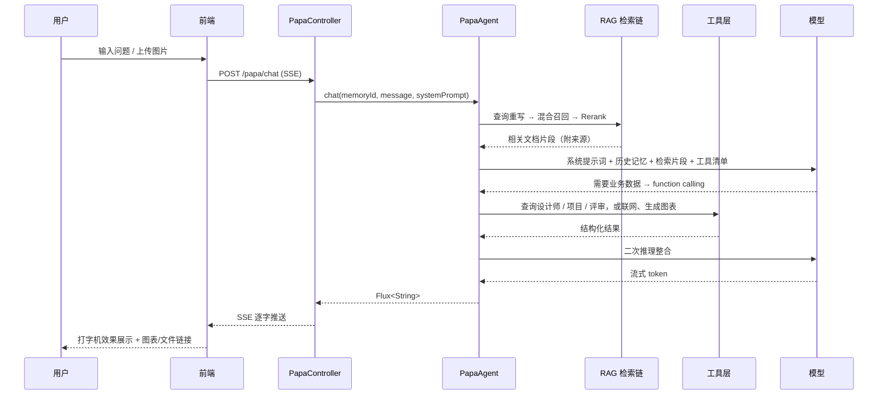

# 纺织行业多模态 AI 智能体（PAPA）

> 面向纺织行业的知识型 AI 工作台：把「行业知识库 + 业务系统数据 + 联网检索 + 图表/文档生成」收进一个对话框里。

[](https://openjdk.org/projects/jdk/17/)
[](https://spring.io/projects/spring-boot)
[](https://github.com/langchain4j/langchain4j)
[](https://vuejs.org/)
[](./LICENSE)

基于 **Spring Boot 3 + langchain4j + Vue 3** 构建的纺织行业领域多模态智能体平台。支持流式对话、RAG 知识库检索、
图片理解与生成、语音输入、文档解析（含扫描件 OCR）、MCP 工具调用（联网搜索 / 图表生成 / Excel 导出），
以及纺织设计师档案、纺织设计项目、纺织设计评审、评审会议预约等业务数据的自然语言查询。

> 项目代号 `PAPA`。本仓库由「工业设计」业务域整体改造为「纺织行业」业务域，
> 改造范围涵盖后端业务模型、提示词、前端文案、数据库脚本与说明文档。

---

## 一、它解决什么问题

纺织行业的方案设计、工艺评审、标准核对高度依赖**分散的专业经验**：面料参数散落在 Excel 里，
检测标准写在 GB/T、FZ/T 文件里，设计师的项目进度和评审记录躺在业务系统中，流行趋势又要临时上网查。
传统做法是「人工翻资料 + 反复问同事」，效率低且结论难追溯。

PAPA 把这条链路压成一个对话：

1. **知识有出处** —— 行业文档入库为向量检索，回答附带原文依据，不靠模型凭空编造；
2. **数据能穿透** —— 通过 function calling 直接查设计师档案、项目阶段、评审评分，无需切系统；
3. **产出可落地** —— 一句话生成趋势图表、参数对比 Excel，直接用于汇报与打样沟通；
4. **语气像行家** —— 通过提示词工程固化行业术语与表述规范（纱支、捻度、克重、色牢度、缸差、Oeko-Tex……）。

---

## 二、功能特性

**对话内核**
- SSE 流式输出，逐字返回，支持中途停止生成
- 多轮上下文记忆，基于 MySQL 持久化，刷新页面/换设备可续聊
- 历史会话列表与内容回放
- 智能体人格一键切换（`papa` 行业顾问 / `requirements` 需求规范专家），改配置不改代码
- 提示词模板热更新，运行时可重新加载

**RAG 知识库**
- 文档上传（单文件 / 批量）、列表、删除、处理日志
- Milvus 向量库持久化检索，两阶段召回（向量召回 → DashScope Rerank 精排）
- 混合检索：向量 + 关键词，RRF 融合排序
- 查询重写：纺织同义词扩展（如「克重 / 平方米克重」、「色牢度 / 耐洗色牢度」）
- 语义缓存：相似问题命中缓存，降低时延与 Token 消耗

**多模态输入输出**
- 图片理解（面料照片、花型稿、检测报告截图）
- 文生图（DashScope wanx，异步轮询生成任务）
- 语音输入（阿里云智能语音识别）
- 文件问答：Word / Excel / PDF / TXT 解析，扫描件自动回退 OCR（Tesseract）

**工具调用（MCP + 本地 @Tool）**
- 联网搜索（智谱 / 百度）
- AntV 图表生成（柱/饼/折线，导出图片）
- Excel 生成与导出
- 业务查询工具：纺织设计师档案、设计项目、设计评审、评审会议预约

**工程化**
- JWT 鉴权、图形验证码、统一响应体、全局异常处理
- LLM 调用与 MCP 工具执行的结构化日志（可开关、可限长）
- Milvus 不可用自动降级为内存向量库，保证本地能跑起来
- Knife4j 在线接口文档

---

## 三、系统架构



### 一次提问的完整链路



---

## 四、技术栈

### 后端

| 组件 | 版本 / 说明 |
|---|---|
| Java | 17 |
| Spring Boot | 3.2.6 |
| langchain4j | 1.13.0-beta23（含 DashScope、Reactor 流式、MCP） |
| MyBatis-Plus | 3.5.5 |
| MySQL | 5.5+（`mysql-connector-j`） |
| Redis | Spring Data Redis |
| Milvus | 2.4.x（向量数据库，`langchain4j-milvus`） |
| 大模型 / 向量 | 阿里云百炼 DashScope（qwen 对话、text-embedding 向量、wanx 文生图） |
| 文档解析 | Apache Tika、PDFBox、POI、Tesseract OCR（tess4j 5.9.0） |
| 其他 | JWT（jjwt 0.11.2）、EasyCaptcha、Knife4j（OpenAPI3） |

### 前端

| 组件 | 版本 |
|---|---|
| Vue | 3.5 |
| Vite | 5.4 |
| Element Plus | 2.8 |
| 其他 | vue-router 4、axios、markdown-it、uuid、sass |

---

## 五、目录结构

```
textile-agent/
├── pom.xml                          # Maven 配置（artifactId: java-ChatLLM-langchain4j）
├── application-local.yml.example    # 本地密钥配置模板（复制为 application-local.yml 使用）
├── docker-compose-milvus.yml        # Milvus + etcd + MinIO 一键编排
│
├── src/main/java/com/zoe/java/ai/langchain4j/
│   ├── PapaApplication.java         # 启动类
│   ├── assistant/                   # AI Service 接口（PapaAgent、PapaAgentNoTools…）
│   ├── config/                      # Milvus / RAG / MCP / 提示词组装 / 日志监听 等配置
│   ├── controller/                  # papa / login / rag / textile designer
│   ├── service/ + service/impl/     # 业务服务（检索、重写、重排、缓存、OCR…）
│   ├── tools/                       # langchain4j @Tool 工具集
│   ├── entity/ vo/ dto/ mapper/     # 持久化实体、视图对象、传输对象、Mapper
│   ├── store/                       # MySQL 对话记忆存储
│   ├── interceptor/                 # JWT 鉴权拦截器
│   └── result/ constant/ annotation/ converter/ util/
│
├── src/main/resources/
│   ├── application.yml              # 主配置（端口 8082，密钥走环境变量）
│   ├── papa-prompt-template.txt     # 人格一：纺织行业领域顾问 PAPA
│   ├── requirements-engineering-prompt-template.txt  # 人格二：需求规范专家 TEXTILE-Spec
│   └── mapper/                      # MyBatis XML
│
├── papa-ui/                         # 前端工程（Vue 3 + Vite）
│   └── src/{components, api, router, store, utils, constants}
│
├── sql/                             # 数据库脚本（建库 / 建表 / 初始数据 / 迁移）
├── scripts/                         # 启动脚本与 OCR 语言包下载脚本
├── docs/                            # 各模块详细说明文档（见文末索引）
├── documents/rag_uploads/           # RAG 知识库文档存放目录
└── tessdata/                        # Tesseract OCR 语言包（不入库，按需下载）
```

---

## 六、快速开始

### 1. 前置依赖

| 依赖 | 版本要求 | 说明 |
|---|---|---|
| JDK | **17**（必需，非 JRE） | `mvn compile` 需要 JDK |
| Node.js | 18+（建议 20/22） | 前端构建 |
| Maven | 3.6+ | 后端构建 |
| MySQL | 5.5+ | 默认库名 `LLM` |
| Redis | 任意 | 默认 `127.0.0.1:6379` |
| Milvus | 2.4.x | 默认 `localhost:19530`，缺失时自动降级 |
| Tesseract 语言包 | 可选 | 扫描件 PDF 走 OCR，见 [docs/OCR_SETUP.md](./docs/OCR_SETUP.md) |

一键拉起 Milvus（首次会自动下载镜像）：

```bash
docker compose -f docker-compose-milvus.yml up -d
```

### 2. 初始化数据库

```bash
# 建库 + 建表（按顺序执行）
mysql -u root -p < sql/create_database.sql
mysql -u root -p llm < sql/create_user_tables.sql
mysql -u root -p llm < sql/create_chat_history_table.sql
mysql -u root -p llm < sql/create_textile_design_tables.sql

# 初始化数据
mysql -u root -p llm < sql/insert_user.sql                     # 初始账号 user / 123456
mysql -u root -p llm < sql/insert_textile_designer_test_data.sql  # 纺织设计师测试数据（可选）
mysql -u root -p llm < sql/add_user_id_to_chat_messages.sql    # 仅存量库升级时需要
```

> **存量库（工业设计域）升级**：先备份，再执行 `sql/migrate_to_textile_design.sql`。它会完成
> `designer_profile → textile_designer_profile`、`design_project → textile_design_project`、
> `design_review → textile_design_review`、`design_review_appointment → textile_review_appointment`
> 的表名与字段重命名，并将设计师编号前缀由 `DES` 迁移为 `TEX`。

### 3. 配置密钥（重要）

仓库中的 `application.yml` **不含任何真实密钥**，全部通过环境变量或本地文件注入。

**方式 A：本地配置文件（推荐本地开发）**

```bash
cp application-local.yml.example application-local.yml
# 编辑 application-local.yml，填入自己的 Key
```

`application.yml` 通过 `spring.config.import: optional:file:./application-local.yml` 自动加载该文件，
文件不存在时静默跳过；`application-local.yml` 已被 `.gitignore` 忽略，不会被提交。

**方式 B：环境变量（推荐容器 / CI 部署）**

| 环境变量 | 用途 |
|---|---|
| `DASHSCOPE_API_KEY` | 阿里云百炼 Key，对话 / 向量 / 图片 / 语音识别共用 |
| `ALIYUN_ACCESS_KEY_ID` / `ALIYUN_ACCESS_KEY_SECRET` | 阿里云 RAM 子账号，语音识别用 |
| `ALIYUN_SPEECH_APP_KEY` | 智能语音交互项目 AppKey |
| `ZHIPU_API_KEY` / `BAIDU_API_KEY` | 联网搜索 MCP |
| `MYSQL_URL` / `MYSQL_USERNAME` / `MYSQL_PASSWORD` | 数据源（默认 `localhost:3306/LLM`，root/123456） |
| `REDIS_HOST` / `REDIS_PORT` | Redis（默认 127.0.0.1:6379） |
| `MILVUS_HOST` / `MILVUS_PORT` | Milvus（默认 localhost:19530） |

> ⚠️ 提交代码前请确认 `git status` 中没有 `application-local.yml`。

### 4. 启动后端

```bash
mvn clean package -DskipTests
java -jar target/java-ChatLLM-langchain4j-1.0-SNAPSHOT.jar
# 或
mvn spring-boot:run
```

Windows 也可以直接用脚本：`powershell -ExecutionPolicy Bypass -File scripts\start_backend.ps1`

- 服务端口：**8082**（`server.port`）
- 接口文档：<http://localhost:8082/doc.html>
- 启动后 `TextileDesignerDataInitializer` 会检测 `textile_designer_profile` 表，为空时自动写入测试数据

### 5. 启动前端

```bash
cd papa-ui
npm install
npm run dev        # 开发，默认 http://localhost:5173
npm run build      # 生产构建
```

Vite 代理规则（`vite.config.js`）：浏览器请求 `/api/**` → 去掉 `/api` 前缀 → 转发到 `http://localhost:8082`。

| 前端请求 | 后端实际路径 |
|---|---|
| `/api/papa/**` | `/papa/**` |
| `/api/admin/**` | `/admin/**` |
| `/api/rag/**` | `/rag/**` |
| `/api/textile/designer/**` | `/textile/designer/**` |

> ⚠️ `server.port` 与 `vite.config.js` 的 `proxy.target` 必须一致，改端口时两边都要改，否则前端接口全部 404。

前端页面：`/login`（登录）、`/chat`（对话工作台）、`/rag`（知识库管理）。

---

## 七、核心能力详解

### 1. 流式对话

`POST /papa/chat` 返回 `text/stream`（SSE），附带：

- 多轮上下文记忆：`MySqlChatMemoryStore` 按 `memoryId` 持久化，会话可跨端恢复
- 联网搜索开关：`webSearchEnabled`
- 停止生成：`POST /papa/chat/stop/{memoryId}`
- 历史会话：`GET /papa/history`、`GET /papa/history/{memoryId}/content`

### 2. 多模态

| 能力 | 接口 | 说明 |
|---|---|---|
| 图片理解 | `POST /papa/readImageContent` | 未传提示词时使用纺织专业视角的默认提示词 |
| 图片生成 | `POST /papa/generateImage` | DashScope wanx，异步轮询任务 |
| 语音输入 | 阿里云智能语音识别 | 前端录音上传，后端转写后进入对话 |
| 文件问答 | `POST /papa/uploadFile` | Tika 解析 Word/Excel/PDF/TXT，扫描件自动回退 OCR |

### 3. RAG 知识库

- 文档上传（单文件 / 批量）、列表、删除：`/rag/**`
- 向量库：Milvus，集合 **`textile_knowledge`**（1024 维，与 embedding 模型对齐）
- 检索链：查询重写 → 混合召回（向量 + 关键词 RRF）→ Rerank 精排 → 语义缓存
- 检索参数集中在 `application.yml` 的 `rag.*`，可按场景调节 `recall-topk`、`min-score`、`final-topk`

> ⚠️ 集合名从 `industrial_design_knowledge` 改为 `textile_knowledge` 后，**旧向量不会自动迁移**。
> 请清理 `documents/rag_uploads/` 中的旧领域文档，上传纺织行业文档（纺织材料、纱线织造、印染后整理、
> 花型图案、检测标准、可持续纺织等）重建索引。详见 [docs/RAG_DEPLOYMENT.md](./docs/RAG_DEPLOYMENT.md)。

### 4. MCP 工具

| 工具 | 说明 | 文档 |
|---|---|---|
| 联网搜索 `webSearchPro` | 智谱 / 百度，按需开启 | [docs/MCP_LOGGING_GUIDE.md](./docs/MCP_LOGGING_GUIDE.md) |
| AntV 图表生成 | 柱状 / 饼图 / 折线，调用时须传 `width=1400&height=900` | [docs/ANTV_CHART_MCP_GUIDE.md](./docs/ANTV_CHART_MCP_GUIDE.md) |
| Excel 生成 | 面料参数、检测结果整理导出 | [docs/EXCEL_GENERATION_GUIDE.md](./docs/EXCEL_GENERATION_GUIDE.md) |

### 5. 智能体人格切换

修改 `application.yml` 的 `agent.active-type` 即可切换角色，**无需改代码**（重启生效）：

| active-type | 模板文件 | 角色 |
|---|---|---|
| `papa` | `papa-prompt-template.txt` | 纺织行业领域 AI 智能体顾问 |
| `requirements` | `requirements-engineering-prompt-template.txt` | 纺织设计需求与规范专家 `TEXTILE-Spec` |

模板支持热更新：`PapaSystemPromptComposer` 会缓存模板，调用 `reloadTemplate(agentType)` 可在运行时
重新加载指定模板（改完 `.txt` 不必重启整个应用）。

模板中两个占位符：`{{current_date}}`（当前日期）、`{{skillContent}}`（附加 Skill 说明，当前传空串）。

### 6. 业务数据查询（function calling）

**`TextileDesignQueryTools`**（Bean：`textileDesignQueryTools`）

| 工具名 | 说明 |
|---|---|
| 查询纺织设计师档案 | 按姓名或 `TEX` 编号查询 |
| 查询纺织设计项目 | 目标、阶段、验收标准、进度 |
| 查询纺织设计评审 | 评审报告与多维评分（创新性/实用性/专业/协作/工艺可行性） |
| 查询纺织设计师完整信息 | 档案 + 项目 + 评审 |
| 按专业方向查询纺织设计师 | 面料设计、服装设计、家纺设计、花型设计、印染工艺 |

**`TextileReviewAppointmentTools`**（Bean：`textileReviewAppointmentTools`）

| 工具名 | 说明 |
|---|---|
| 预约纺织设计评审 | 预约评审会议（先查排期并请用户确认） |
| 取消纺织设计评审预约 | 取消已存在的预约 |
| 查询评审排期 | 按项目 / 日期 / 时间 / 专家查询 |

两者在 `PapaAgent` 中通过 `@AiService(tools = {...})` 注册。

---

## 八、API 一览

| 分组 | 路径 | 说明 |
|---|---|---|
| 对话 | `POST /papa/chat` | 流式对话（SSE） |
| 对话 | `POST /papa/chat/stop/{memoryId}` | 停止生成 |
| 对话 | `GET /papa/history` | 历史会话列表 |
| 对话 | `GET /papa/history/{memoryId}/content` | 会话内容 |
| 多模态 | `POST /papa/readImageContent` | 图片理解 |
| 多模态 | `POST /papa/generateImage` | 图片生成 |
| 多模态 | `POST /papa/uploadFile` | 文件问答（流式） |
| 多模态 | `GET /papa/downloadImage` | 下载生成图片 |
| 认证 | `GET /admin/login/captcha` | 获取图形验证码 |
| 认证 | `POST /admin/login` | 登录，返回 JWT |
| RAG | `POST /rag/upload`、`POST /rag/upload-batch` | 上传文档 |
| RAG | `GET /rag/documents`、`GET /rag/logs` | 文档列表 / 处理日志 |
| 纺织设计师 | `GET /textile/designer/getByName?name=` | 按姓名查询 |
| 纺织设计师 | `GET /textile/designer/getByNo?designerNo=` | 按编号查询 |
| 纺织设计师 | `GET /textile/designer/list` | 设计师列表 |
| 纺织设计师 | `GET /textile/designer/getBySpecialty?specialty=` | 按专业方向查询 |
| 纺织设计师 | `GET /textile/designer/designProjects?designerId=` | 设计项目 |
| 纺织设计师 | `GET /textile/designer/reviews?designerId=` | 设计评审 |
| 纺织设计师 | `GET /textile/designer/detail?designerId=` | 完整信息 |

> **鉴权**：`AuthenticationInterceptor` 仅拦截 `/admin/**` 与 `/papa/**`（`/admin/login*` 放行）。
> 登录成功后前端在 `Authorization` 与 `access-token` 两个 Header 中携带 JWT。

---

## 九、数据模型

| 表 | 说明 | 关键字段 |
|---|---|---|
| `system_user` | 系统用户 | username、password(MD5)、type、status |
| `chat_messages` | 对话历史 | memory_id、user_id、role、content |
| `textile_designer_profile` | 纺织设计师档案 | designer_no(`TEX001`)、specialty、experience_years、achievements、skill_tags、total_projects、total_awards |
| `textile_design_project` | 纺织设计项目 | designer_id、project_name、stage、design_cycle、design_objectives、acceptance_criteria、project_status |
| `textile_design_review` | 纺织设计评审 | designer_id、project_id、overall_score、innovation_score、usability_score、processability_score、review_status |
| `textile_review_appointment` | 评审会议预约 | username、project_name、date、time、reviewer_name |

字段级说明见 [docs/database_schema_documentation.md](./docs/database_schema_documentation.md)
与 [`sql/create_textile_design_tables.sql`](./sql/create_textile_design_tables.sql)。

---

## 十、常见问题

**Q1. `mvn compile` 报 "No compiler is provided in this environment"**
当前 `java` 指向的是 JRE。请安装 JDK 17 并确保 `JAVA_HOME` 指向 JDK 而非 JRE。

**Q2. 启动直接报 API Key 为空 / 401**
没有配置 `application-local.yml`，也没设置环境变量。按「六.3 配置密钥」任选一种方式补齐。

**Q3. RAG 上传成功但检索不到内容**
确认 `application.yml`、`MilvusConfig`、`MilvusDataChecker`、`MilvusCollectionResetter`
四处集合名一致（应全部为 `textile_knowledge`）；集合改名后需重新上传文档。

**Q4. 启动时报 `textile_designer_profile` 表不存在**
先执行 `sql/create_textile_design_tables.sql`。`TextileDesignerDataInitializer` 启动时会访问该表。

**Q5. Milvus 连不上**
Milvus 不可用时会自动降级为内存 `InMemoryEmbeddingStore`（重启丢失），不影响启动。
需要持久化请先 `docker compose -f docker-compose-milvus.yml up -d`。

**Q6. 改了 `.env.development` 的 `VITE_APP_TITLE` 不生效**
已修复：`utils/index.js` 的 `getEnvByName` 优先读取 `import.meta.env`，取不到才回退默认值。

**Q7. Windows 下 `mvn spring-boot:run` 报 `CreateProcess error=206`**
命令行过长所致。改用 `mvn package` + `java -jar`（`scripts/start_backend.ps1` 已按此方式实现）。

---

## 十一、文档索引

| 文档 | 内容 |
|---|---|
| [docs/TEXTILE_DESIGNER_MANAGEMENT_GUIDE.md](./docs/TEXTILE_DESIGNER_MANAGEMENT_GUIDE.md) | 设计师 / 设计项目管理模块：表结构、API、AI 工具用法 |
| [docs/TEXTILE_DESIGN_QUERY_TOOLS_GUIDE.md](./docs/TEXTILE_DESIGN_QUERY_TOOLS_GUIDE.md) | 设计师查询工具与评审预约工具使用说明 |
| [docs/database_schema_documentation.md](./docs/database_schema_documentation.md) | 数据库表结构总览 |
| [docs/RAG_DEPLOYMENT.md](./docs/RAG_DEPLOYMENT.md) | RAG 与 Milvus 部署、集合重建步骤、故障排查 |
| [docs/RAG_COMPLETION_SUMMARY.md](./docs/RAG_COMPLETION_SUMMARY.md) | RAG 功能实现总结 |
| [docs/MCP_LOGGING_GUIDE.md](./docs/MCP_LOGGING_GUIDE.md) | MCP 工具调用与日志观测（联网搜索场景） |
| [docs/ANTV_CHART_MCP_GUIDE.md](./docs/ANTV_CHART_MCP_GUIDE.md) | 图表生成工具使用说明 |
| [docs/EXCEL_GENERATION_GUIDE.md](./docs/EXCEL_GENERATION_GUIDE.md) | Excel 生成工具使用说明 |
| [docs/FILE_UPLOAD_GUIDE.md](./docs/FILE_UPLOAD_GUIDE.md) | 文件上传与解析说明 |
| [docs/OCR_SETUP.md](./docs/OCR_SETUP.md) / [docs/README_OCR.md](./docs/README_OCR.md) | Tesseract OCR 环境配置 |
| [sql/migrate_to_textile_design.sql](./sql/migrate_to_textile_design.sql) | 存量库从工业设计域迁移到纺织行业域（含回滚说明） |

---

## 十二、参与开发

- 分支：`master` 为主干，功能开发走 `feat/xxx`，修复走 `fix/xxx`
- 提交信息：建议遵循 Conventional Commits（`feat:` / `fix:` / `docs:` / `refactor:`）
- 新增 AI 工具的步骤：在 `tools/` 下新建 `@Tool` 方法 → 在 `PapaAgent` 的 `@AiService(tools = {...})` 注册
  → 在对应提示词模板中补充工具使用策略 → 更新 `docs/` 说明
- **提交前自查**：`git status` 中不出现 `application-local.yml`、`target/`、`tessdata/`、`*.log`

---

## 十三、许可

本项目基于 [MIT License](./LICENSE) 开源。

模型调用依赖阿里云百炼 DashScope 等第三方服务，使用前请自行申请账号并遵守其服务条款；
仓库内不包含任何真实密钥，示例知识库文档仅用于功能演示。
